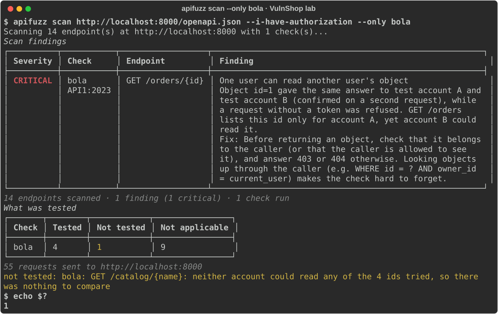
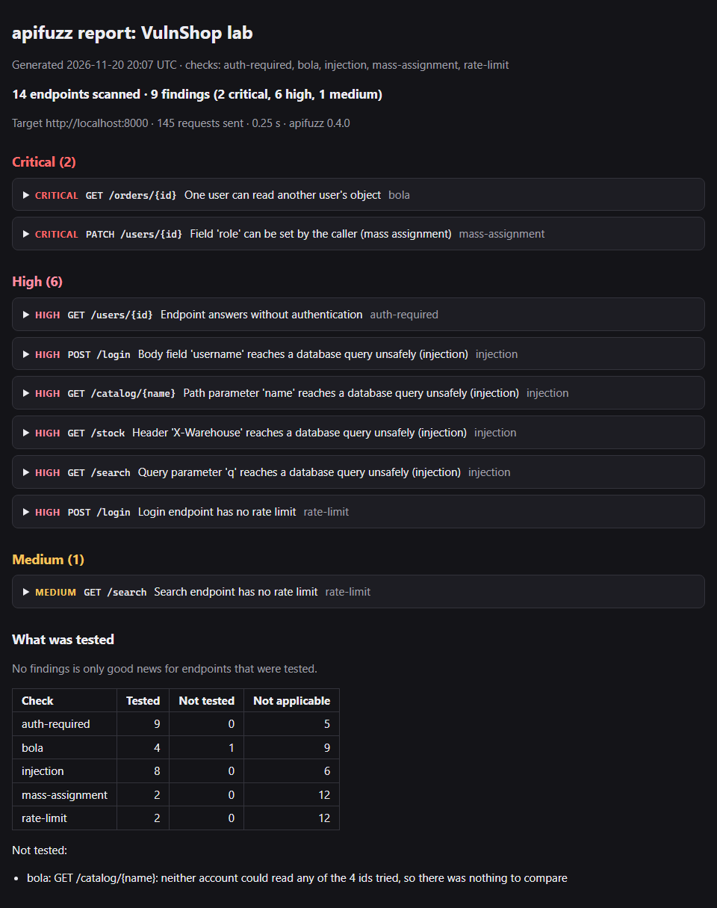
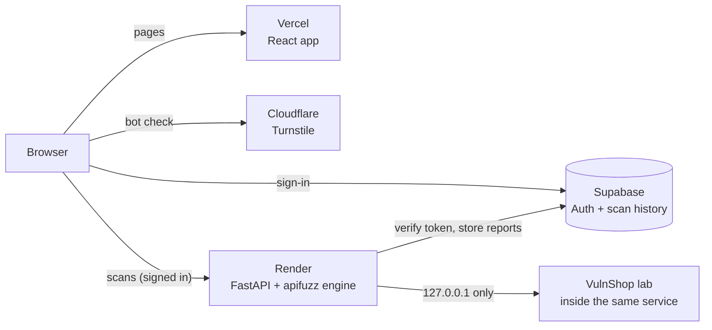
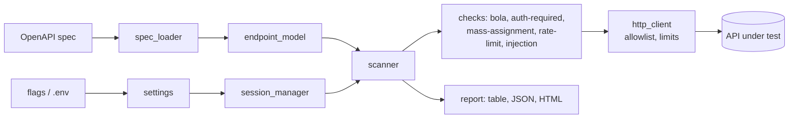

# apifuzz

A command-line security scanner that reads an OpenAPI/Swagger spec and tests the API it
describes for common OWASP API Top 10 flaws. You point it at an API you are authorized to test,
give it two test accounts, and get a report a developer can act on: the endpoint, the evidence,
the severity, and the fix.

**Try it in the browser:** <https://apifuzz.vercel.app>. Sign in and scan VulnShop, a
deliberately vulnerable demo API, or your own API once you've proven you control it, with the same engine. The [sample report](https://apifuzz.vercel.app/sample)
needs no account. See [Hosted demo](#hosted-demo).

> **Status.** Five checks work today: `bola` (BOLA/IDOR by token swapping), `auth-required`,
> `mass-assignment`, `rate-limit` and `injection` (SQL/NoSQL, detection only). Reports come
> as tables, JSON, HTML and SARIF (for GitHub code scanning). Every check is verified against the bundled VulnShop lab on each test run.
> The hosted demo is live: a web app on Vercel and its scan server on Render.

**Contents:** [What it checks](#what-it-checks) · [Quickstart](#quickstart) ·
[Scan your own API](#scan-your-own-api) · [Use it in CI](#use-it-in-ci) · [Reports](#reports) ·
[How each check works](#how-each-check-works) · [Lab target](#lab-target-vulnshop) ·
[Hosted demo](#hosted-demo) · [Architecture](#architecture) · [Develop](#develop) ·
[Scope & ethics](#scope--ethics) · [What's next](#whats-next)

The planted BOLA flaw in the bundled lab, found by swapping two test accounts' tokens:



All five checks against the same lab:

```text
$ make demo
...
   14 endpoints scanned · 9 findings (2 critical, 6 high, 1 medium) · 5 checks run
                     What was tested
+--------------------------------------------------------+
| Check           | Tested | Not tested | Not applicable |
|-----------------+--------+------------+----------------|
| auth-required   |      9 |          0 |              5 |
| bola            |      4 |          1 |              9 |
| injection       |      8 |          0 |              6 |
| mass-assignment |      2 |          0 |             12 |
| rate-limit      |      2 |          0 |             12 |
+--------------------------------------------------------+
        145 requests sent to http://localhost:8000
not tested: bola: GET /catalog/{name}: neither account could read any of the 4 ids tried, so
there was nothing to compare
```

The same scan as a standalone HTML report (`--html report.html`), grouped by severity with each
finding expandable to its request and response evidence:



## What it checks

| Check | OWASP | How it works, in one line |
| --- | --- | --- |
| `bola` | API1:2023 | Logs in as two users and checks whether one can read the other's objects (`GET /orders/{id}`). |
| `auth-required` | API2:2023 | Calls endpoints the spec says need a login with no credentials, and reports the ones that answer. |
| `mass-assignment` | API3:2023 | Sends an update or create with one extra field the spec doesn't list (such as `role`) and reads the object back to see if it was saved. |
| `rate-limit` | API4:2023 | Sends a small burst of identical requests to login and search endpoints (one at a time, or several at once with `--concurrency`) and looks for a `429` or rate-limit headers. |
| `injection` | API8:2019 | Sends inert marker values to query-string parameters, path parameters and headers of GET endpoints, and to JSON body fields of login/search endpoints, and watches the response *shape* for a database error, an always-true/always-false differential, or an accepted NoSQL operator object. Detection only. |

All probes are meant to detect a flaw, not to use it. Details for each check are under
[How each check works](#how-each-check-works).

## Quickstart

Needs Python 3.11 or newer, and Docker for the demo.

```bash
python -m venv .venv
# Windows: .venv\Scripts\activate      macOS/Linux: source .venv/bin/activate
pip install -e ".[dev]"

make demo                        # macOS/Linux, or Windows with make
powershell -File lab/demo.ps1    # Windows without make
```

The demo boots VulnShop (a deliberately vulnerable API, see [Lab target](#lab-target-vulnshop))
in Docker, logs in both lab accounts, scans it, and writes `report.html` and `report.json`.

## Scan your own API

```bash
apifuzz checks                                         # list the available checks
apifuzz endpoints openapi.json                         # see what the spec contains; sends nothing
apifuzz scan openapi.json --i-have-authorization --base-url https://staging.example.com
```

`scan` refuses to run without `--i-have-authorization`. It contacts only the base URL's host,
plus any `--allow host[:port]` entries, and never follows redirects. A spec given as a URL is
downloaded under the same rules: only from the host you typed, and a redirect is an error that
names where it points. A `$ref` may only point inside the spec (`#/components/...`): one that names
another file or URL is refused before anything is fetched or read, so a spec can't send apifuzz
anywhere else. Bundle a multi-file spec into one document first.

**The target.** Pass `--base-url` or set `APIFUZZ_BASE_URL`. Without either, the spec's `servers`
entry is used only if the spec was downloaded from that same host, or you listed the host with
`--allow`. A spec is a document: it may not choose the target (and receive your test tokens) on
its own.

**Test accounts.** `bola` needs two different accounts, A and B; `mass-assignment` needs A. Give
each one either a token (`APIFUZZ_TOKEN_A` / `_B`) or a username and password (`APIFUZZ_USER_A` /
`APIFUZZ_PASSWORD_A`, and the same for B). They are read only from the environment or `.env`
(see [.env.example](.env.example)), never from flags, so they stay out of shell history.

- With a username and password, apifuzz POSTs them to `APIFUZZ_LOGIN_PATH` (default `/login`) and
  reads the token from the answer. `APIFUZZ_LOGIN_FORMAT=form` sends form fields instead of JSON;
  `APIFUZZ_LOGIN_USER_FIELD` / `APIFUZZ_LOGIN_PASSWORD_FIELD` rename the fields.
- The token is sent the way the spec's security scheme says: a bearer token, an API-key header,
  a cookie, an API key in the query string (`?api_key=…`), or HTTP basic auth.
  `APIFUZZ_AUTH_HEADER` / `APIFUZZ_AUTH_PREFIX` override that, and `APIFUZZ_AUTH_QUERY=<name>`
  sends the token as a query parameter instead.
- With HTTP basic auth (the spec's scheme, or `APIFUZZ_AUTH_PREFIX=Basic`) nothing is POSTed: the
  username and password are sent with each request as `Authorization: Basic …`.
- Before scanning, each token is tried on a protected endpoint. The scan stops if a token is
  refused, if A and B have the same token, or if both turn out to be the same user. Otherwise it
  would test nothing and report a clean API, or "prove" two accounts can read each other's data.
- If a token expires during the scan, the account logs in again and the request is retried
  once. A `401` alone doesn't trigger that: the token is first tried on a "who am I" endpoint,
  and only a token that fails there too is renewed (at most 3 times per account). This needs a
  username and password; a token given directly can't be renewed. Replaced tokens are redacted
  from reports like the current ones.

| Option | What it does |
| --- | --- |
| `--base-url` | Root URL of the API |
| `--allow` | Extra host the scan may contact (repeatable) |
| `--only` / `--skip` | Run only, or leave out, a check id (repeatable) |
| `-m`, `-p`, `-t`, `--auth` | Scan only some endpoints: by method, path pattern, tag, or login needed (`login`/`none`) |
| `--shared` | Path pattern whose objects are shared between users on purpose, e.g. `'/posts/*'`; `bola` skips it (repeatable) |
| `--burst` | Requests the `rate-limit` check sends to one endpoint (default 15, at most 50) |
| `--concurrency` | How many of those requests are in flight at once (default 1, at most 10) |
| `--max-requests` | Stop the scan after this many requests (default 1000) |
| `--delay` | Seconds to wait between requests |
| `--timeout` | Seconds to wait for each response (default 10) |
| `--require-docker` | Only scan if every target is a running local Docker container. See below. |
| `--fail-on` | Exit 1 if any finding is at least this severe: `info`…`critical`, or `never` (default `high`) |
| `--json` | Print the report as JSON instead of tables |
| `--json-out FILE` / `--html FILE` | Also write a JSON report, or a standalone HTML report (one file, no scripts) |
| `--sarif FILE` | Also write a SARIF 2.1.0 report for GitHub code scanning. See [Use it in CI](#use-it-in-ci). |
| `--accepted FILE` | A file of accepted findings: still reported, but they don't count towards `--fail-on` |
| `--write-accepted FILE` | Write a starting accepted-findings file from this scan, with the reasons left to fill in |
| `--redact` / `--no-redact` | Make reports safe to share (default: on). See [Reports](#reports). |

**Exit codes:** `0` no findings at or above `--fail-on`; `1` findings at or above it; `2` usage
or configuration error, a failed login or dead token, or a target where no request got an answer.
An unreachable API is an error, not a clean result, so it can't pass a CI job by being down.

Every request carries `User-Agent: apifuzz/<version>`, so the target's logs show where the
traffic came from.

### Docker-only mode

With `--require-docker` (or `APIFUZZ_REQUIRE_DOCKER=1`), apifuzz asks Docker which containers are
running before it sends anything. It scans only if the base URL, every `--allow` entry, and the
spec URL (when the spec is downloaded) are ports that one of them publishes. The host must be
written as `localhost`, `127.0.0.1`, `::1`, or a container's own IP; other hostnames are refused
without a DNS lookup. The allowlist then holds only those exact `host:port` pairs. Check a target
on its own, without scanning, with:

```bash
apifuzz verify-docker http://localhost:8000
```

## Use it in CI

Two things make a scan usable as a CI gate: a report the platform can show, and a way to keep the
job green for findings you already know about.

**SARIF.** `--sarif FILE` writes the findings as SARIF 2.1.0, which GitHub code scanning reads.
Each finding points at the endpoint's operation in the spec file, so it shows up next to the
route's definition, with its severity (critical / high / medium / low) and a fingerprint that
keeps it the same alert from run to run. GitHub takes the severity label from the check, not the
single finding, so every alert of a check shows that check's worst severity in the run (a
medium search rate limit is labelled high when the same scan found a high login one); the
report files keep each finding's own severity. Evidence is left out of the SARIF file; use
`--html` or `--json-out` for that.

**Accepted findings.** `--accepted FILE` names a JSON file of findings you have decided to live
with. They are still listed in every report, marked as accepted, but no longer count towards
`--fail-on`, so the job fails only for something new. Every entry needs a written reason:

```json
{
  "accepted": [
    {
      "fingerprint": "3f2a9c0d1b7e4a55",
      "check": "rate-limit",
      "endpoint": "GET /search",
      "reason": "Throttled at the gateway, which the scan does not go through."
    }
  ]
}
```

`--write-accepted FILE` writes a starting file with this scan's findings and empty reasons. Fill
in a reason for the ones you accept, delete the rest, and commit the file. A file with a missing
reason is refused, and an entry that no longer matches any finding is pointed out so you can
remove it.

A workflow for your own repository (staging URL and test accounts come from repository secrets):

```yaml
name: API security scan
on:
  pull_request:
  schedule:
    - cron: "0 3 * * 1"

permissions:
  contents: read
  security-events: write   # lets the job upload SARIF to code scanning

jobs:
  apifuzz:
    runs-on: ubuntu-latest
    steps:
      - uses: actions/checkout@v4
      - uses: actions/setup-python@v5
        with:
          python-version: "3.12"
      - run: pip install apifuzz
      - name: Scan staging
        env:
          APIFUZZ_BASE_URL: ${{ secrets.STAGING_URL }}
          APIFUZZ_TOKEN_A: ${{ secrets.APIFUZZ_TOKEN_A }}
          APIFUZZ_TOKEN_B: ${{ secrets.APIFUZZ_TOKEN_B }}
        run: >
          apifuzz scan openapi.json --i-have-authorization
          --sarif apifuzz.sarif --accepted apifuzz-accepted.json --fail-on high
      - uses: github/codeql-action/upload-sarif@v4
        if: always()   # upload the findings even when the scan step failed the job
        with:
          sarif_file: apifuzz.sarif
```

The scan step exits `1` when there is an open finding at or above `--fail-on`, which fails the
job; the upload step still runs. Code scanning is free on public repositories and needs GitHub
Advanced Security on private ones. Without it, drop the upload step and keep the exit code.

This repository does the same with its own lab: the CI demo job uploads the VulnShop scan, so the
planted flaws appear under the repository's **Security → Code scanning** tab, each one on the
line of [lab/openapi.json](lab/openapi.json) that declares the endpoint.

## Reports

Every finding has a severity, its OWASP category, the evidence (the exact requests and
responses), a fix, and a `fingerprint` that stays the same between runs so two reports can be
compared. A finding is reported only after a repeated request confirms it.

Every report also says **what was tested**. For each check it counts the endpoints it tested,
the ones it could not judge (with the reason), and the ones it doesn't apply to. "No findings"
is only good news for endpoints that were tested.

With `--redact` (the default), JSON and HTML reports are safe to attach to a ticket:

- `Authorization`, cookie and API-key headers are hidden, and the test accounts' tokens are
  replaced wherever else they appear (URLs, bodies, warnings).
- In bodies, values of fields such as `email`, `phone`, `password` and `token` are masked, and
  e-mail addresses are masked in plain text. A BOLA finding's evidence is another user's data.
- Bodies are cut to a short excerpt.

The JSON report carries `schema_version`, `tool_version`, `target`, `started_at`, `duration_s`
and `requests_sent`.

## How each check works

**`bola`.** First it does recon: it calls the protected GET endpoints that take no id (such as
`/me` or `/orders`) as account A and as account B, and notes which ids each account is shown,
and on which endpoint. Those real ids (numbers or strings such as UUIDs), plus 1–5 for numeric
ids, are requested on every `GET /thing/{id}` as A and as B. An object that both accounts receive
(the same object, not just the same status code), while a request with no token is refused, is
reported once a second request confirms it:

- **CRITICAL** when ownership is proven: `GET /orders` lists the id for one account only, yet
  the other could read `GET /orders/{id}`.
- **HIGH** when it is likely: the object has an owner field (`owner`, `user_id`...). That is not
  proof, because a public post names its author too.
- **LOW** when nothing shows whose object it is. It may be shared on purpose.
- Not reported: an object the API itself lists to both accounts, and paths marked `--shared`.

Ids are attributed per collection: an id seen in `/orders` says nothing about `/products/{id}`.
On a nested path such as `/users/{userId}/orders/{orderId}` the last id is probed and the ids
before it are filled with account A's own, so the question is whether B can read an object under
A's part of the tree. Only GET endpoints are probed, and recon sends only GETs.

**`auth-required`.** For GET/HEAD endpoints the spec marks as needing a login: one request with
no credentials. A 2xx answer, confirmed by a second request, is HIGH. A 401/403 is correct. Any
other answer (a 404 for the sample id, a 5xx) is counted as not tested.

**`mass-assignment`.** For PATCH/PUT endpoints, on one of account A's own objects: it reads the
object, then sends the update with one extra field the spec doesn't list as writable, and reads
the object back. A field that was saved is a finding: CRITICAL if it controls what the user may
do (`role`, `is_admin`, `verified`...), HIGH otherwise. The probe proves the flaw without using
it: a text field is set to the marker `apifuzz-probe`, never to `admin`, and the original value
is put back afterwards (the finding says whether that worked). Ids, owner fields, timestamps and
secrets are never written to. Create (POST) endpoints are probed the same way, but only when the
spec also has a DELETE and a GET for the created object: every object made for the test is
deleted straight after it is read, and the report names any that could not be. Without a DELETE
the endpoint is listed as not tested.

**`rate-limit`.** For login-like POST endpoints and search-like GET endpoints: a burst of
identical requests, stopping at the first `429` or `Retry-After` / `RateLimit-*` header. Answers
that get several times slower as the burst goes on also count as throttling. If the whole burst
is answered with no sign of throttling, a login endpoint is HIGH and a search endpoint MEDIUM.
Login attempts use made-up credentials for a user that doesn't exist. Endpoints that create data
or send messages (sign-up, password reset) are never burst. By default the requests go one after
another, the gentlest choice for staging. Some limiters only count requests that arrive at the
same time; `--concurrency N` keeps N in flight at once to catch those, and the finding says
which way the burst was sent. This is detection, not a load test: the burst is capped at 50 and
the concurrency at 10.

**`injection`.** On one input at a time it sends a benign baseline value, then a value with one
extra quote (`apifuzz'`), then an always-true and an always-false value (`apifuzz' OR '1'='1' -- `
/ `apifuzz' AND '1'='2' -- `). A database error in the answer to the quote, or a result set that
differs between the always-true and always-false values, means the input is reaching a query
unescaped — HIGH, once the signal repeats on a second request. What is probed:

- On GET/HEAD endpoints: query-string parameters, path parameters (`/catalog/{name}`), and the
  header parameters the spec declares (`X-Tenant`). The login header, `Cookie` and the standard
  HTTP headers are left alone. For a path or header value a `404` counts as a real answer, since
  a made-up value is usually "not found"; a header value is sent without trailing whitespace,
  which HTTP doesn't allow.
- JSON body fields on endpoints that read or authenticate (login / search / lookup / query
  shaped). For body fields it also sends an operator object (`{"$ne": …}`) where a scalar is
  expected, to catch NoSQL operator injection.

Create and update endpoints are never probed with a body, and path values of DELETE/PATCH/PUT
endpoints are never probed, so the check can neither create nor change data. The markers are
inert, and it counts records, never reads their contents.

## Lab target (VulnShop)

`lab/` contains VulnShop, a tiny deliberately vulnerable API (spec:
[lab/openapi.json](lab/openapi.json)). Each planted flaw is marked `PLANTED` in
[lab/app.py](lab/app.py); everything else behaves correctly, so a finding anywhere else is a
false positive.

| Route | Behaviour | Expected result |
| --- | --- | --- |
| `GET /orders/{id}` | Planted: checks the login but not the order's owner | `bola` (CRITICAL) |
| `GET /users/{id}` | Planted: doesn't check the login at all | `auth-required` (HIGH) |
| `PATCH /users/{id}` | Planted: saves every field in the body, including `role` | `mass-assignment` (CRITICAL) |
| `POST /login` | Planted: accepts any number of attempts, and pastes `username` into a SQL user lookup | `rate-limit` (HIGH), `injection` (HIGH) |
| `GET /search` | Planted: accepts any number of searches, and pastes `q` into a SQL query | `rate-limit` (MEDIUM), `injection` (HIGH) |
| `GET /catalog/{name}` | Planted: pastes the path value into a SQL query | `injection` (HIGH) |
| `GET /stock` | Planted: pastes the `X-Warehouse` header into a SQL query | `injection` (HIGH) |
| `GET /me`, `GET /orders` | Correct: only the caller's own data | nothing |
| `POST /orders`, `DELETE /orders/{id}` | Correct: saves only the fields the spec allows; you can delete only your own orders | nothing |
| `GET /products/{id}` | Correct: shared on purpose with every logged-in user | nothing |
| `GET /invoices/{id}` | Correct: only the owner can read an invoice | nothing |

With `LAB_HARDENED=1` every planted flaw is fixed. This is the known-negative variant, and a scan
of it must report nothing:

```bash
LAB_HARDENED=1 docker compose up -d --wait   # PowerShell: $env:LAB_HARDENED="1"; docker compose up -d --wait
```

The hardened lab limits logins to 5 per 30 seconds, so a second scan started right away is
refused at login with a clear message. Wait half a minute.

The container listens on `127.0.0.1:8000` only, runs as a non-root user with a read-only
filesystem and no capabilities, and keeps its data in memory (seeded the same way on every
start). The app refuses to start without `DEMO_MODE=1` and marks every response with an
`X-VulnShop-Lab` header, so it can't be mistaken for a real service.

Step by step instead of `make demo`:

```bash
docker compose up -d --build --wait          # start (first run builds the image)
apifuzz verify-docker http://localhost:8000  # confirm it's the lab container
apifuzz scan http://localhost:8000/openapi.json --i-have-authorization --require-docker --html report.html
docker compose down                          # stop
```

Lab accounts: `alice`/`alice` (token `lab-token-alice`) and `bob`/`bob` (token `lab-token-bob`).
They exist only in the lab, so it's fine to put them in `.env`.

## Hosted demo

<https://apifuzz.vercel.app> runs this engine behind a sign-in. Anyone can create an account
(Google, or e-mail and password), pick the checks, scan the VulnShop lab, and read the report:
the same findings, evidence and fixes as the CLI. A scan runs in the background: its page shows
the phase it is in, how far the checks have got and the requests it is sending, with a Cancel
button that stops it between two steps and keeps what it found so far. Reports are kept for 30
days and only their owner can open them. Two scans of the same target can be
compared: what is new, what was fixed, and what is still open (a finding that is missing only
counts as fixed if the later scan tested that endpoint again). The
[sample report](https://apifuzz.vercel.app/sample) is public.

**Your own API.** Add it on the Your APIs page (HTTPS, a public address), with its spec linked
(on the same address) or uploaded as a file, for APIs that don't publish theirs. Then prove you
control it: publish the line the page gives you at `https://<your API>/.well-known/apifuzz-verify.txt`
and press Check now. The file is checked again before every scan, so taking it down withdraws the
permission. The site's operator can still approve or reject an API by hand, in Supabase. In the scan form you paste
bearer tokens of two test accounts for that scan; they are never stored. Without a public
address, use the CLI ([Scan your own API](#scan-your-own-api)).

No API of your own to try it on? [testapi/](testapi/) is a practice API with fake data and
simulated flaws that you can deploy to Vercel in a few clicks, in a vulnerable, a fixed and an
unpublished-spec variant.

Limits: 5 scans per account per day, 50 for the whole server, one scan at a time, at most 400
requests per scan; up to 3 own APIs per account, each scanned at most 3 times a day.



| Part | Where | What it does |
| --- | --- | --- |
| [frontend/](frontend/) | Vercel | React 19 + TypeScript (Vite, SCSS). Sign-in, new scan, history, reports, terms and privacy pages. |
| [backend/](backend/) | Render (free tier) | FastAPI. Checks the sign-in, enforces the limits, runs the engine, stores the redacted report. |
| VulnShop lab | inside the backend | Started by [backend/start.sh](backend/start.sh) on `127.0.0.1`, so only the scanner can reach it. |
| Supabase | EU | Accounts, sign-in, sign-in e-mails (sent through Brevo), and the `scans` and `targets` tables. |

How it is kept safe:

- **Sign-in.** The backend verifies every Supabase token against the project's public keys
  (ES256, audience, issuer). There are no roles: every account gets the same limits and sees
  only its own scans and APIs; the operator works in the Supabase dashboard, not in the app.
  Google sign-in uses apifuzz's own button: Google returns a one-time code, the backend exchanges
  it with the client secret, and Google's screen shows apifuzz, not Supabase.
- **Accounts.** Sign-up and password reset give the same answer whether or not an address has an
  account. An account created with Google can never get a password (a database rule). The e-mail
  forms carry a Cloudflare Turnstile bot check that Supabase verifies.
- **Scanning.** Only the lab and APIs whose owner proved control (or the operator approved): the
  target's host is the engine's whole allowlist, the spec download never follows a redirect, a
  spec can't refer to other documents, and the server's own environment never reaches the engine.
  For a user's API every connection, the proof file's included, is checked at connect time and
  pinned to a public address (no private, loopback, metadata or similar addresses, even if the
  name's DNS answer changes mid-scan), and answers are capped at 5 MB. Specs that use YAML aliases
  are refused, because a few hundred bytes of them can expand without limit and stall the parser.
  Test-account tokens are never stored and are removed from every report.
- **The API.** Rate limits per address and per account (and separate ones for proof checks,
  uploads and watching a scan's progress), a 16 KB body cap (1.5 MB only for a spec upload),
  strict CORS (only the site), security headers, and validation errors that never echo the input.
  The `scans` and `targets` tables have row-level security with no policies, so browsers can't
  read them at all, and the server may change only a target's approval and spec columns.
- **The site.** A strict Content Security Policy (scripts only from the site, Google's sign-in
  and Cloudflare's check), self-hosted fonts, no tracking or analytics, and terms and privacy
  pages.
- **Scanned by itself.** apifuzz was run against the demo's own backend. The first run showed the
  API spec didn't declare which routes need a sign-in, so those couldn't be checked; once it did,
  the scan found no flaws.

On the free tier the backend sleeps after 15 minutes without traffic, so the first request after
a quiet spell takes about a minute. Setting it up yourself: [backend/README.md](backend/README.md)
(Supabase, Google, e-mail, Turnstile, Render) and [frontend/README.md](frontend/README.md)
(Vercel).

## Architecture



The HTTP client is the only code that touches the target. Checks share one interface
(`Check.run(endpoint, context)`), so adding a check is one new module.

| File | What it does |
| --- | --- |
| `src/apifuzz/spec_loader.py` | Reads a spec from a file or URL, resolves its `$ref`s, validates it, and turns problems into clear errors. |
| `src/apifuzz/endpoint_model.py` | Turns the spec into a plain list of `Endpoint` objects. |
| `src/apifuzz/settings.py` | Combines flags, environment/`.env` and the spec into scan settings, including how tokens are sent and which target is confirmed. |
| `src/apifuzz/session_manager.py` | Logs the two test accounts in, checks their tokens work and belong to two different users, and logs an account in again if its token expires mid-scan. |
| `src/apifuzz/http_client.py` | The only code that sends requests to a target. Enforces the allowlist and the request limit, never follows redirects, adds the account's credentials, and records each request and response as evidence. |
| `src/apifuzz/checks/` | One module per check. `base.py` defines `Check`, `ScanContext` and the registry. |
| `src/apifuzz/scanner.py` | Runs the chosen checks over the chosen endpoints, and collects findings and coverage. |
| `src/apifuzz/finding.py` | The `Finding` record, its fingerprint, and the severity scale. |
| `src/apifuzz/report.py` | Shows results as tables, JSON or a standalone HTML report, redacted. |
| `src/apifuzz/sarif.py` | Writes the SARIF 2.1.0 report, pointing each finding at its operation in the spec. |
| `src/apifuzz/accepted.py` | Reads and writes the file of accepted findings. |
| `src/apifuzz/docker_verify.py` | `--require-docker`: confirms each target is a running local container. |
| `src/apifuzz/cli.py` | The `apifuzz` command: `endpoints`, `checks`, `scan`, `verify-docker`. |
| `src/apifuzz/errors.py` | The error types shown to the user as plain messages. |
| `tests/` | Unit tests against a fake network, plus ground-truth scans of the real lab app in both modes. |

The web app around the engine lives in `frontend/` and `backend/` (see [Hosted demo](#hosted-demo)).

## Develop

```bash
ruff check .      # style and likely bugs
mypy              # types
pytest --cov      # tests, with a coverage report (fails under 90%)
```

`uv.lock` pins the exact dependency versions; `uv sync --extra dev` installs from it.

The tests need no Docker: they run the lab app in-process and require exactly the lab table's
results from the normal lab and no findings from the hardened one. CI
([.github/workflows/ci.yml](.github/workflows/ci.yml)) runs them on Linux and Windows for Python
3.11 to 3.13, and also boots the real container and runs the demo scan.

The web app has its own checks:

```bash
cd backend && uv sync && uv run pytest && uv run ruff check . && uv run mypy src
cd frontend && npm install && npm run build   # type-checks, then builds
```

## Scope & ethics

Use this only on APIs you own or have written permission to test. The tool is built to make the
wrong thing hard: `scan` requires `--i-have-authorization`, the HTTP client enforces a host
allowlist, a spec cannot choose the target, and requests are capped. It detects flaws with
minimal requests and does not exploit them: probes use marker values, changes are put back, and
login attempts use an account that doesn't exist. It is not a tool for scanning third-party
services.

## Releasing

Publishing to PyPI is automated by [.github/workflows/release.yml](.github/workflows/release.yml)
using PyPI Trusted Publishing (OIDC), so no API token is stored. One-time setup: register this
repo as a pending publisher at <https://pypi.org/manage/account/publishing/> (project `apifuzz`,
workflow `release.yml`, environment `pypi`), and create a GitHub environment named `pypi`. To cut
a release: bump `version` in `pyproject.toml` (PyPI refuses a re-upload of an existing version),
then publish a GitHub Release with a tag like `v0.2.0`. The workflow builds, runs `twine check`,
and uploads. The published version is the one in `pyproject.toml`, not the git tag.

## What's next

The plan's four phases are built, and so is the hosted demo's roadmap: self-service proof of
control, scans in the background with progress and Cancel, comparing scans, and spec upload.
Ideas beyond it:

- **A DNS record as proof**, for APIs that can't serve a file under `/.well-known/`.
- **A short queue** instead of "one scan at a time, try again in a minute".
