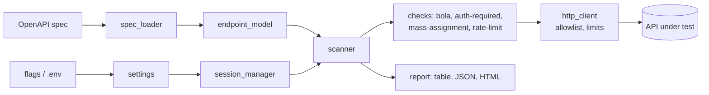

# apifuzz

A command-line security scanner that reads an OpenAPI/Swagger spec and tests the API it
describes for common OWASP API Top 10 flaws. You point it at an API you are authorized to test,
give it two test accounts, and get a report a developer can act on: the endpoint, the evidence,
the severity, and the fix.

> **Status.** Four checks work today: `bola` (BOLA/IDOR by token swapping), `auth-required`,
> `mass-assignment` and `rate-limit`. Injection (SQL/NoSQL) and SARIF output are planned, not
> built. Every check is verified against the bundled VulnShop lab on each test run.

```text
$ make demo
...
   12 endpoints scanned · 5 findings (2 critical, 2 high, 1 medium) · 4 checks run
                     What was tested
+--------------------------------------------------------+
| Check           | Tested | Not tested | Not applicable |
|-----------------+--------+------------+----------------|
| auth-required   |      7 |          0 |              5 |
| bola            |      4 |          0 |              8 |
| mass-assignment |      2 |          0 |             10 |
| rate-limit      |      2 |          0 |             10 |
+--------------------------------------------------------+
        100 requests sent to http://localhost:8000
```

## What it checks

| Check | OWASP | How it works, in one line |
| --- | --- | --- |
| `bola` | API1:2023 | Logs in as two users and checks whether one can read the other's objects (`GET /orders/{id}`). |
| `auth-required` | API2:2023 | Calls endpoints the spec says need a login with no credentials, and reports the ones that answer. |
| `mass-assignment` | API3:2023 | Sends an update or create with one extra field the spec doesn't list (such as `role`) and reads the object back to see if it was saved. |
| `rate-limit` | API4:2023 | Sends a small burst of identical requests to login and search endpoints and looks for a `429` or rate-limit headers. |

All probes are meant to detect a flaw, not to use it. Details for each check are under
[How each check works](#how-each-check-works).

## Quickstart

Needs Python 3.11 or newer, and Docker for the demo.

```bash
python -m venv .venv
# Windows: .venv\Scripts\activate      macOS/Linux: source .venv/bin/activate
pip install -e ".[dev]"

make demo                        # macOS/Linux, or Windows with make
powershell -File lab/demo.ps1    # Windows without make
```

The demo boots VulnShop (a deliberately vulnerable API, see [Lab target](#lab-target-vulnshop))
in Docker, logs in both lab accounts, scans it, and writes `report.html` and `report.json`.

## Scan your own API

```bash
apifuzz checks                                         # list the available checks
apifuzz endpoints openapi.json                         # see what the spec contains; sends nothing
apifuzz scan openapi.json --i-have-authorization --base-url https://staging.example.com
```

`scan` refuses to run without `--i-have-authorization`. It contacts only the base URL's host,
plus any `--allow host[:port]` entries, and never follows redirects.

**The target.** Pass `--base-url` or set `APIFUZZ_BASE_URL`. Without either, the spec's `servers`
entry is used only if the spec was downloaded from that same host, or you listed the host with
`--allow`. A spec is a document: it may not choose the target (and receive your test tokens) on
its own.

**Test accounts.** `bola` needs two different accounts, A and B; `mass-assignment` needs A. Give
each one either a token (`APIFUZZ_TOKEN_A` / `_B`) or a username and password (`APIFUZZ_USER_A` /
`APIFUZZ_PASSWORD_A`, and the same for B). They are read only from the environment or `.env`
(see [.env.example](.env.example)), never from flags, so they stay out of shell history.

- With a username and password, apifuzz POSTs them to `APIFUZZ_LOGIN_PATH` (default `/login`) and
  reads the token from the answer. `APIFUZZ_LOGIN_FORMAT=form` sends form fields instead of JSON;
  `APIFUZZ_LOGIN_USER_FIELD` / `APIFUZZ_LOGIN_PASSWORD_FIELD` rename the fields.
- The token is sent the way the spec's security scheme says (a bearer token, an API-key header,
  or a cookie). `APIFUZZ_AUTH_HEADER` / `APIFUZZ_AUTH_PREFIX` override that.
- Before scanning, each token is tried on a protected endpoint. The scan stops if a token is
  refused, if A and B have the same token, or if both turn out to be the same user. Otherwise it
  would test nothing and report a clean API, or "prove" two accounts can read each other's data.

| Option | What it does |
| --- | --- |
| `--base-url` | Root URL of the API |
| `--allow` | Extra host the scan may contact (repeatable) |
| `--only` / `--skip` | Run only, or leave out, a check id (repeatable) |
| `-m`, `-p`, `-t`, `--auth` | Scan only some endpoints: by method, path pattern, tag, or login needed (`login`/`none`) |
| `--shared` | Path pattern whose objects are shared between users on purpose, e.g. `'/posts/*'`; `bola` skips it (repeatable) |
| `--burst` | Requests the `rate-limit` check sends to one endpoint (default 15, at most 50) |
| `--max-requests` | Stop the scan after this many requests (default 1000) |
| `--delay` | Seconds to wait between requests |
| `--timeout` | Seconds to wait for each response (default 10) |
| `--require-docker` | Only scan if every target is a running local Docker container. See below. |
| `--fail-on` | Exit 1 if any finding is at least this severe: `info`…`critical`, or `never` (default `high`) |
| `--json` | Print the report as JSON instead of tables |
| `--json-out FILE` / `--html FILE` | Also write a JSON report, or a standalone HTML report (one file, no scripts) |
| `--redact` / `--no-redact` | Make reports safe to share (default: on). See [Reports](#reports). |

**Exit codes:** `0` no findings at or above `--fail-on`; `1` findings at or above it; `2` usage
or configuration error, a failed login or dead token, or a target where no request got an answer.
An unreachable API is an error, not a clean result, so it can't pass a CI job by being down.

Every request carries `User-Agent: apifuzz/<version>`, so the target's logs show where the
traffic came from.

### Docker-only mode

With `--require-docker` (or `APIFUZZ_REQUIRE_DOCKER=1`), apifuzz asks Docker which containers are
running before it sends anything. It scans only if the base URL, every `--allow` entry, and the
spec URL (when the spec is downloaded) are ports that one of them publishes. The host must be
written as `localhost`, `127.0.0.1`, `::1`, or a container's own IP; other hostnames are refused
without a DNS lookup. The allowlist then holds only those exact `host:port` pairs. Check a target
on its own, without scanning, with:

```bash
apifuzz verify-docker http://localhost:8000
```

## Reports

Every finding has a severity, its OWASP category, the evidence (the exact requests and
responses), a fix, and a `fingerprint` that stays the same between runs so two reports can be
compared. A finding is reported only after a repeated request confirms it.

Every report also says **what was tested**. For each check it counts the endpoints it tested,
the ones it could not judge (with the reason), and the ones it doesn't apply to. "No findings"
is only good news for endpoints that were tested.

With `--redact` (the default), JSON and HTML reports are safe to attach to a ticket:

- `Authorization`, cookie and API-key headers are hidden, and the test accounts' tokens are
  replaced wherever else they appear (URLs, bodies, warnings).
- In bodies, values of fields such as `email`, `phone`, `password` and `token` are masked, and
  e-mail addresses are masked in plain text. A BOLA finding's evidence is another user's data.
- Bodies are cut to a short excerpt.

The JSON report carries `schema_version`, `tool_version`, `target`, `started_at`, `duration_s`
and `requests_sent`.

## How each check works

**`bola`.** First it does recon: it calls the protected GET endpoints that take no id (such as
`/me` or `/orders`) as account A and as account B, and notes which ids each account is shown,
and on which endpoint. Those real ids (numbers or strings such as UUIDs), plus 1–5 for numeric
ids, are requested on every `GET /thing/{id}` as A and as B. An object that both accounts receive
(the same object, not just the same status code), while a request with no token is refused, is
reported once a second request confirms it:

- **CRITICAL** when ownership is proven: `GET /orders` lists the id for one account only, yet
  the other could read `GET /orders/{id}`.
- **HIGH** when it is likely: the object has an owner field (`owner`, `user_id`...). That is not
  proof, because a public post names its author too.
- **LOW** when nothing shows whose object it is. It may be shared on purpose.
- Not reported: an object the API itself lists to both accounts, and paths marked `--shared`.

Ids are attributed per collection: an id seen in `/orders` says nothing about `/products/{id}`.
On a nested path such as `/users/{userId}/orders/{orderId}` the last id is probed and the ids
before it are filled with account A's own, so the question is whether B can read an object under
A's part of the tree. Only GET endpoints are probed, and recon sends only GETs.

**`auth-required`.** For GET/HEAD endpoints the spec marks as needing a login: one request with
no credentials. A 2xx answer, confirmed by a second request, is HIGH. A 401/403 is correct. Any
other answer (a 404 for the sample id, a 5xx) is counted as not tested.

**`mass-assignment`.** For PATCH/PUT endpoints, on one of account A's own objects: it reads the
object, then sends the update with one extra field the spec doesn't list as writable, and reads
the object back. A field that was saved is a finding: CRITICAL if it controls what the user may
do (`role`, `is_admin`, `verified`...), HIGH otherwise. The probe proves the flaw without using
it: a text field is set to the marker `apifuzz-probe`, never to `admin`, and the original value
is put back afterwards (the finding says whether that worked). Ids, owner fields, timestamps and
secrets are never written to. Create (POST) endpoints are probed the same way, but only when the
spec also has a DELETE and a GET for the created object: every object made for the test is
deleted straight after it is read, and the report names any that could not be. Without a DELETE
the endpoint is listed as not tested.

**`rate-limit`.** For login-like POST endpoints and search-like GET endpoints: a burst of
identical requests, one after another, stopping at the first `429` or `Retry-After` /
`RateLimit-*` header. Answers that get several times slower as the burst goes on also count as
throttling. If the whole burst is answered with no sign of throttling, a login endpoint
is HIGH and a search endpoint MEDIUM. Login attempts use made-up credentials for a user that
doesn't exist. Endpoints that create data or send messages (sign-up, password reset) are never
burst. This is detection, not a load test: the burst is capped at 50.

## Lab target (VulnShop)

`lab/` contains VulnShop, a tiny deliberately vulnerable API (spec:
[lab/openapi.json](lab/openapi.json)). Each planted flaw is marked `PLANTED` in
[lab/app.py](lab/app.py); everything else behaves correctly, so a finding anywhere else is a
false positive.

| Route | Behaviour | Expected result |
| --- | --- | --- |
| `GET /orders/{id}` | Planted: checks the login but not the order's owner | `bola` (CRITICAL) |
| `GET /users/{id}` | Planted: doesn't check the login at all | `auth-required` (HIGH) |
| `PATCH /users/{id}` | Planted: saves every field in the body, including `role` | `mass-assignment` (CRITICAL) |
| `POST /login` | Planted: accepts any number of attempts | `rate-limit` (HIGH) |
| `GET /search` | Planted: accepts any number of searches | `rate-limit` (MEDIUM) |
| `GET /me`, `GET /orders` | Correct: only the caller's own data | nothing |
| `POST /orders`, `DELETE /orders/{id}` | Correct: saves only the fields the spec allows; you can delete only your own orders | nothing |
| `GET /products/{id}` | Correct: shared on purpose with every logged-in user | nothing |
| `GET /invoices/{id}` | Correct: only the owner can read an invoice | nothing |

With `LAB_HARDENED=1` every planted flaw is fixed. This is the known-negative variant, and a scan
of it must report nothing:

```bash
LAB_HARDENED=1 docker compose up -d --wait   # PowerShell: $env:LAB_HARDENED="1"; docker compose up -d --wait
```

The hardened lab limits logins to 5 per 30 seconds, so a second scan started right away is
refused at login with a clear message. Wait half a minute.

The container listens on `127.0.0.1:8000` only, runs as a non-root user with a read-only
filesystem and no capabilities, and keeps its data in memory (seeded the same way on every
start). The app refuses to start without `DEMO_MODE=1` and marks every response with an
`X-VulnShop-Lab` header, so it can't be mistaken for a real service.

Step by step instead of `make demo`:

```bash
docker compose up -d --build --wait          # start (first run builds the image)
apifuzz verify-docker http://localhost:8000  # confirm it's the lab container
apifuzz scan http://localhost:8000/openapi.json --i-have-authorization --require-docker --html report.html
docker compose down                          # stop
```

Lab accounts: `alice`/`alice` (token `lab-token-alice`) and `bob`/`bob` (token `lab-token-bob`).
They exist only in the lab, so it's fine to put them in `.env`.

## Architecture



The HTTP client is the only code that touches the target. Checks share one interface
(`Check.run(endpoint, context)`), so adding a check is one new module.

| File | What it does |
| --- | --- |
| `src/apifuzz/spec_loader.py` | Reads a spec from a file or URL, resolves its `$ref`s, validates it, and turns problems into clear errors. |
| `src/apifuzz/endpoint_model.py` | Turns the spec into a plain list of `Endpoint` objects. |
| `src/apifuzz/settings.py` | Combines flags, environment/`.env` and the spec into scan settings, including how tokens are sent and which target is confirmed. |
| `src/apifuzz/session_manager.py` | Logs the two test accounts in, and checks their tokens work and belong to two different users. |
| `src/apifuzz/http_client.py` | The only code that sends requests to a target. Enforces the allowlist and the request limit, never follows redirects, and records each request and response as evidence. |
| `src/apifuzz/checks/` | One module per check. `base.py` defines `Check`, `ScanContext` and the registry. |
| `src/apifuzz/scanner.py` | Runs the chosen checks over the chosen endpoints, and collects findings and coverage. |
| `src/apifuzz/finding.py` | The `Finding` record, its fingerprint, and the severity scale. |
| `src/apifuzz/report.py` | Shows results as tables, JSON or a standalone HTML report, redacted. |
| `src/apifuzz/docker_verify.py` | `--require-docker`: confirms each target is a running local container. |
| `src/apifuzz/cli.py` | The `apifuzz` command: `endpoints`, `checks`, `scan`, `verify-docker`. |
| `src/apifuzz/errors.py` | The error types shown to the user as plain messages. |
| `tests/` | Unit tests against a fake network, plus ground-truth scans of the real lab app in both modes. |

## Develop

```bash
ruff check .
pytest
```

`uv.lock` pins the exact dependency versions; `uv sync --extra dev` installs from it.

The tests need no Docker: they run the lab app in-process and require exactly the lab table's
results from the normal lab and no findings from the hardened one. CI
([.github/workflows/ci.yml](.github/workflows/ci.yml)) runs them on Linux and Windows for Python
3.11 to 3.13, and also boots the real container and runs the demo scan.

## Scope & ethics

Use this only on APIs you own or have written permission to test. The tool is built to make the
wrong thing hard: `scan` requires `--i-have-authorization`, the HTTP client enforces a host
allowlist, a spec cannot choose the target, and requests are capped. It detects flaws with
minimal requests and does not exploit them: probes use marker values, changes are put back, and
login attempts use an account that doesn't exist. It is not a tool for scanning third-party
services.

## What's next

- Injection check (SQL/NoSQL), the last of the four planned categories.
- SARIF 2.1.0 output for GitHub code scanning, and a file of accepted findings.
